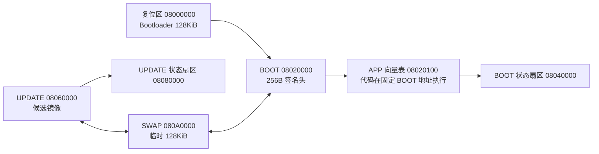
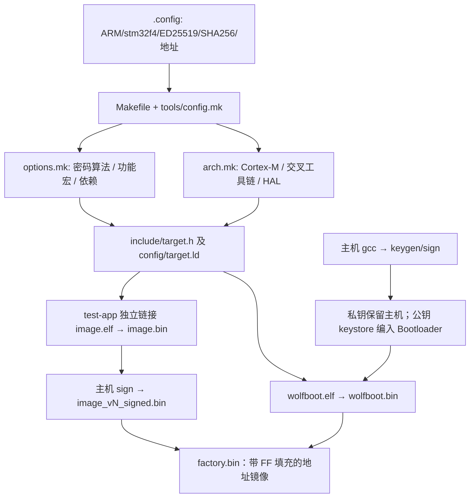

# 1　先把自己的板、镜像和构建接起来

你已经会写 MCU 驱动，可以把 Bootloader 当成“复位后先运行的一个小应用”：它也有启动文件、链接脚本、时钟初始化和 Flash 驱动。额外承担的工作是判断谁有资格运行，以及在新旧程序交换时保住可恢复的副本。先走通一个签名 APP，再研究更新，认知负担会小很多。

本篇所有上游路径均相对 `vendor/wolfBoot/`。上游原始文件的 commit 见 `sources.lock.json`；本包更改见 `patches/`。

## 先核对硬件，暂不烧录

目标假设为 **正点原子探索者、STM32F407ZGT6、1MiB Flash、8MHz 外部晶振、3.3V 供电**。没有用户实物照片或对应修订版原理图，因此这里只核对芯片资料和上游示例，不能确认具体板卡修订版。此前的 `STM32F401TZGT6` 字符串不能当作已经确认的料号：F401 的频率、容量、封装/引脚和外设组合都可能不同，不能用 F407 的 PLL 和 Flash map 烧录。

[ST 的 STM32F407ZG 产品页](https://www.st.com/en/microcontrollers-microprocessors/stm32f407zg.html)给出 Cortex-M4、最高 168MHz、1MiB Flash。192KiB SRAM 的宣传容量包含 CCM 等区域，并不是从 `0x20000000` 开始的一整块 192KiB。上游 Bootloader 链接脚本只使用 `0x1C000` 普通 SRAM，test-app 使用低地址 16KiB；本实验不把 CCM 当 DMA 通用缓冲区。

| 核对项 | 官方源码实际选择 | 探索者学习配置及你应确认的内容 |
|---|---|---|
| MCU | `TARGET=stm32f4`，Discovery 示例 | 假设 F407ZG；看芯片丝印，不只看开发板商品名 |
| Flash | HAL 写死 F407 1MiB 几何 | 探测寄存器显示 1024KiB 才允许本脚本写入；ID 0x413 只能识别 F405/F407 家族，不能识别板型 |
| HSE | `hal/stm32f4.c` 等待外部晶振 | 查板上晶振和对应版本原理图；8MHz 假设不能由芯片 ID 推出 |
| PLL | M=8、N=336、P=2、Q=7 | 8/8×336/2=168MHz，PLL48=48MHz；外部若为 25MHz 必须重算 |
| 时钟宏 | 官方 Discovery 配置是 160000000 | 本包改成 168000000，避免计时参数与实际主频不符 |
| Flash 等待周期 | 上游 F4 Boot HAL 当前写 3 | 本包按 168MHz、2.7～3.6V 改为 5；电压不在该范围需按 RM0090 重查 |
| 总线分频 | Boot HAL APB1 /4、APB2 /2；APP 原代码相反 | overlay 让 APP 同样采用 APB1=42MHz、APB2=84MHz，TIM2/4=84MHz |
| UART | 普通 APP 默认 USART3 PD8/PD9；`USE_UART1` 原为 PB6/PB7 | 本包选 USART1 PA9 TX、PA10 RX，AF7；检查板上 USB-UART 跳帽连线、共地和 3.3V 电平 |
| LED | Discovery PD14、PD15/TIM4_CH4 | 探索者常见资料为 PF9/PF10，但具体板修订未确认；本包 LED GPIO 操作为空，用 GDB 看计时变量 |
| SWD | PA13/PA14 | ST-Link SWDIO/SWCLK/GND/VTref；NRST 可选，BOOT0 置正常用户 Flash 启动 |

不要把 ST-Link 的 USB 接口等同于板上串口。探索者的 USB-UART 是另一条链路；原 examples measured-boot README 中涉及另一块板子的 UDC 说明也不能直接迁移。串口线反接、跳帽没接、总线时钟错，都会导致“程序已经运行但终端无输出”。

## 把物理 Sector 和逻辑分区分开理解

Flash 像一排仓库：写入能逐字节/字进行，但擦除要整间搬空。F407 前几间仓库大小不一样。`WOLFBOOT_SECTOR_SIZE` 是交换算法的搬运单位，不会改变芯片真实 Sector 的尺寸。

| 硬件 Sector | 起始地址 | 大小 | 本包用途 |
|---|---:|---:|---|
| S0 | 0x08000000 | 16KiB | Bootloader |
| S1 | 0x08004000 | 16KiB | Bootloader |
| S2 | 0x08008000 | 16KiB | Bootloader |
| S3 | 0x0800C000 | 16KiB | Bootloader |
| S4 | 0x08010000 | 64KiB | Bootloader，整个预留区合计 128KiB |
| S5 | 0x08020000 | 128KiB | BOOT：签名头与 APP |
| S6 | 0x08040000 | 128KiB | BOOT：状态扇区，不放 APP |
| S7 | 0x08060000 | 128KiB | UPDATE：下载的签名头与 APP/后续旧版备份 |
| S8 | 0x08080000 | 128KiB | UPDATE：状态扇区 |
| S9 | 0x080A0000 | 128KiB | SWAP：一块擦除单位的临时周转区 |
| S10 | 0x080C0000 | 128KiB | 未使用，烧录脚本保留 |
| S11 | 0x080E0000 | 128KiB | 未使用，烧录脚本保留 |



本版本 `src/update_flash.c` 的 `MAX_UPDATE_SIZE` = 分区大小 − 头大小 − 状态扇区大小。因此原始 APP 最大 `0x40000-0x100-0x20000=0x1FF00`，即 **130816 字节**；签名镜像最大 131072 字节。不能把分区容量 256KiB 误报为可放 256KiB APP。`wolfBoot_update_trigger()` 会擦整个 UPDATE 最末扇区；若下载镜像伸入该扇区，会把自己的程序擦掉。

官方 `stm32f407-discovery.config` 目前分区只有一个 128KiB Sector。本包没有照搬这个容量，而按当前 `MAX_UPDATE_SIZE` 和尾部状态擦除行为改为两个 Sector，避免“编译成功但新版本拒绝更新/擦坏镜像”。这是锁定版本下的重要复证结果。链接脚本默认仍可能给 APP 更大的链接空间，因此我们在签名前另外做实际文件长度检查。

## 配置怎样变成代码

这不是把 Linux 的 Kconfig 菜单整个照搬。当前常用入口是 GNU Make 变量文件：顶层 `Makefile` 的 `-include .config` 先读本地变量，再包含 `tools/config.mk` 默认值，`arch.mk` 决定工具链/CPU/平台，`options.mk` 决定算法、宏和相关对象。`?=` 只在变量尚未定义时提供默认值；本包使用 `=` 固定学习配置。命令行 `make SIGN=...` 仍能覆盖，因此实验中不要随手覆盖算法和布局。



你过去在 CubeIDE 里改 `FLASH ORIGIN`、选启动文件，这里仍是同一件事。区别是 Makefile 根据配置替你挑选 HAL 与依赖，然后生成地址头文件/链接脚本。生成文件不应成为地址的第二个维护入口。

## 一步一步构建

在包根目录先检查已安装环境，不用重装：

```bash
arm-none-eabi-gcc --version
arm-none-eabi-gdb --version
openocd --version
make --version
gcc --version
python3 --version
bash scripts/build.sh
```

主机 `gcc` 是编译签名工具用的，ARM GCC 是生成 MCU 固件用的。只有 ARM GCC 而没有主机 C 编译器时，缺的是主机工具构建能力。脚本发现缺少命令会停止。

脚本执行次序可逐条复现：

1. `python3 scripts/prepare.py` 检查上游源码哈希，应用 5 个板级 overlay，复制 `.config`。
2. `make -C vendor/wolfBoot clean` 清目标对象，避免改时钟/布局后误用旧对象。它不是 `keysclean`，不主动销毁密钥。
3. `make -C vendor/wolfBoot keytools` 构建官方 C 语言 `keygen` 和 `sign`。本包使用的版本没有教程中常见的旧 Python keytool 路径。
4. 首次在 wolfBoot 根目录执行 `tools/keytools/keygen --ed25519 -g wolfboot_signing_private_key.der`，生成私钥与 `src/keystore.c`；后续复用。不要把私钥上传 Git。公钥与私钥丢失其一时，先恢复成对备份。
5. `make ... wolfboot.bin test-app/image.bin`。上游顶层包装目标会进入 test-app 子目录；两者分别产生自己的 ELF 和链接结果。该调用建立了构建依赖，但不会把 APP 链接进 Bootloader ELF。
6. 官方 `sign --ed25519 --sha256 image.bin key 版本号`，分别签版本 1/2/3。本包三个版本先用相同 APP 字节，只有签名头中的版本和相关签名不同，便于控制变量做升级/回滚实验。
7. `scripts/images.py` 检查 MSP、Thumb 入口、头长度、TLV 和容量，再合并工厂镜像。布局检查**不是验签**，认证由目标上的 wolfBoot 完成。

`build/` 中应出现：

| 文件 | 用途 |
|---|---|
| wolfboot.elf / wolfboot.bin | Bootloader 调试符号 / 裸二进制 |
| image.elf / image.bin | APP 调试符号 / 不含签名头的二进制 |
| image_v1/2/3_signed.bin | 每个都有 256B 镜像头，烧到分区起点 |
| factory.bin | 从 0x08000000 到 0x080BFFFF 的 0xC0000 字节文件；空洞和状态区填 FF |
| boot-symbols.txt / app-symbols.txt | 现场核对真实符号，尤其 main、isr_reset、wolfBoot_start |
| wolfboot.map / app.map | 检查代码/RAM/栈的实际占用 |
| logs/ | 构建结果、版本和哈希；本地执行后才有 |

工厂镜像显式包含空白 UPDATE/SWAP 和状态区，避免第一次实验残留旧状态。单独重刷小 APP 文件并不会自动清理旧 trailer。重新开始实验使用完整工厂镜像，并理解它会擦哪些扇区。

本包不假设你的 ARM GCC 小版本与本机一致。若 `-Werror` 报警，先保存完整命令和版本，不要先全局关闭警告；若没有发生编译，不能根据文件名就声称产物存在。构建完成后再运行 `python3 scripts/images.py inspect build/image_v1_signed.bin` 和 `arm-none-eabi-size build/*.elf` 复证。
