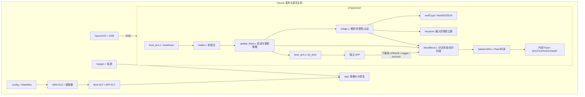

# 4　先做静态设计：边界、分层、接口与数据

以下分析针对锁定 commit、本包 `ARM/stm32f4/ED25519/SHA256`、内部 Flash、默认 SWAP、有备份路径。TPM、外部加密 Flash、Delta、TrustZone、RAM 自更新等属于可选架构，源码中看到并不等于本配置启用。

## 功能需求与系统边界

把项目放回真实产品：开发者在主机生成固件，发布系统签名，设备 APP 负责收到文件，Bootloader 在复位窗口决定能否执行。wolfBoot 核心不负责你的业务下载服务器、Wi-Fi 驱动和用户界面。

| 需求 | 责任方 | 本实验判据 |
|---|---|---|
| 只执行被授权且内容未改的 APP | image 模块、wolfCrypt、keystore | 正确镜像进入 APP；坏摘要/错误密钥候选被拒 |
| 更新不直接毁掉唯一运行副本 | UPDATE/BOOT/SWAP 状态机 | 下载只落 UPDATE，交换时保留恢复所需块 |
| 试运行失败恢复旧版 | 状态机 + APP health/watchdog | 新版 TESTING、未 success 后 reset 恢复旧版 |
| 能从中断交换继续 | HAL + 持久化 sector flags + 最终状态阶段 | 多个持久化边界 reset/断电后恢复可认证镜像 |
| 保持 APP 与 Bootloader 解耦 | 分区、头、链接地址、libwolfboot API | 两套 ELF；APP 不调用 Bootloader 内部地址 |
| 发布可追踪 | 主机工具/配置管理 | commit、配置、密钥身份、固件哈希和测试记录 |

这些是设计目标，不能仅凭源文件有对应函数就认定设备满足全部非功能要求。真实 Flash 擦写可靠性、供电、watchdog、启动时长和物理攻击防护需要产品约束与验证。

## 一张组件图建立方向感



图上 `APP → LIB` 表示 APP 链接自己的一份 `src/libwolfboot.c` 和必要 HAL，不是跳到 Bootloader 固定地址执行一个 RPC。源码可复用，运行镜像仍独立。这个模型与你在两个项目都链接同一驱动库完全相同。

## 分层之间真正交换什么

| 层 / 文件 | 对上提供 | 向下依赖 | 不应混进本层的职责 |
|---|---|---|---|
| `src/loader.c` | 复位后的 C 入口 | `hal_init`、可选外设初始化、`wolfBoot_start` | 业务下载协议 |
| `src/update_flash.c` | `wolfBoot_start`，内部 `wolfBoot_update`、copy/final erase | image、状态 API、`wb_flash_*`、HAL、`do_boot` | 芯片寄存器细节 |
| `src/image.c` | open/integrity/authenticity、镜像边界检查 | libwolfboot TLV/分区访问、keystore、wolfCrypt | 选择何时确认业务健康 |
| `src/libwolfboot.c` | `wolfBoot_update_trigger`、`wolfBoot_success`、版本/状态和存储封装 | HAL 或 ext_flash 后端、配置宏 | UART 包协议与服务器连接 |
| `include/wolfboot/wolfboot.h` | APP 公共接口、镜像 TLV/状态常量 | 生成的 target 配置、条件编译 | 业务对象/RTOS 策略 |
| `hal/stm32f4.c` | `hal_init`、`hal_flash_write/erase/unlock/lock`、`hal_prepare_boot` | RCC/FLASH 寄存器、实际 Sector 表 | 是否接受某个签名 |
| `src/boot_arm.c` | 启动向量、`isr_reset`、`do_boot` | CPU 异常/VTOR/MSP/MPU、链接符号 | 网络更新流程 |
| `tools/keytools` | 主机 keygen/sign 文件格式 | 主机 libc/RNG、wolfCrypt | 把私钥放设备 |

`hal_flash_erase(address,len)` 的 address/len 是算法层传来的擦除请求；F4 HAL 将绝对地址转成 Flash 偏移，按 `flash_sector[]` 寻找覆盖的真实 Sector。不能以为任意 4KiB 逻辑请求都只擦 4KiB。`hal_flash_write` 包含忙等待、清错和编程序列；检查返回值沿调用链是否传播，不能只看寄存器最终变化。

`hal/hal.c` 还提供通用/弱符号实现。当前 F4 不实现强版本的 `hal_flash_protect` 时，通用弱实现并不会自动给 Bootloader 设硬件 WRP。因此 `wolfBoot_start` 调用了 protect 并不等于 F407 已建立不可修改的信任根。生产保护必须明确验证实际后端和选项字节策略；学习烧录脚本不擅自改它们。

## 镜像不是一个 ELF 文件

ELF 给链接器/调试器看，包含段地址和符号；设备中的普通签名镜像是二进制结构：

```text
partition start +0x000:  WOLF magic（小端值 0x464C4F57）
                +0x004: 原始固件长度 fw_size（不含头）
                +0x008: TLV：版本、时间戳、类型、摘要、公钥 hint、签名等
                ...   : 按选定头大小填充
                +0x100: APP 向量表：初始 MSP / Thumb Reset 入口 / 异常向量...
                ...   : APP 代码、只读数据、需复制到 RAM 的数据初值
partition final sector: trailer/state/sector flags，必须保留
```

头大小随算法变化。本包固定 Ed25519/SHA256，256B 合适；如果换 RSA/PQC 或添加自定义 TLV，主机工具可能要求更大的头，APP 链接地址也必须随之改变。不要只改 `SIGN=`。

`struct wolfBoot_image` 在 `include/image.h` 的实际软件分支保存：`hdr`、`trailer`、`sha_hash`、`fw_base`、`fw_size`、`part` 及 `hdr_ok/sha_ok/signature_ok`。它是运行期视图，不是直接 memcpy 到磁盘的格式，bitfield 布局也不是协议。`wolfBoot_open_image` 建立这个视图并校验头/大小；不能把 `open` 成功等同于内容可信。

本配置 `fw_base = BOOT + IMAGE_HEADER_SIZE = 0x08020100`。UPDATE 中保存的是同一份、仍按 BOOT 地址链接的 APP：升级时搬到 BOOT 才运行。它不是为 UPDATE 地址另外编译一套可原地执行的程序。

## Hash、签名、公钥的关系

像你用 CRC 校验 UART 包，Hash 首先回答“内容是否与摘要对应”；但攻击者可以改内容后重算 Hash。数字签名再回答“这个摘要是否由被授权私钥持有者签过”。设备用预置公钥验证，设备无需持有私钥。

`src/image.c` 的完整性验证和主机 `tools/keytools/sign.c` 必须对相同范围计算摘要：范围包括签名格式规定的头前缀/元数据与固件内容，不是简单对整个 signed 文件做 SHA256，也不是一概只 hash APP payload。签名字段本身不能循环包含进自己的摘要。阅读时对照 `make_header_ex`、`image_sha256`（具体符号见函数索引）与 TLV 的插入顺序，核对 Hash TLV 之前参与摘要的头部边界。

本配置的外层镜像 Hash 是 SHA256，签名是 Ed25519；Ed25519 内部仍使用 SHA512，因此编译依赖看到 `sha512.c` 并不是配置偷偷变成 SHA512 镜像摘要。`ed25519.c`、`fe_operations.c`、`ge_operations.c` 是算法实现依赖。`SPMATH` 对不同算法分支的作用不同，不要由一个选项推断所有对象必然参与。

镜像内公钥 hint 是帮助从 `src/keystore.c` 找到已授权 key slot 的摘要标识。攻击者把自己的公钥信息塞进头里，不会自动成为新的信任根。`wolfBoot_verify_authenticity()` 还检查镜像类型、key slot 的分区权限、签名长度和实际验签结果。

算法库负责数学正确性，Bootloader 负责“何时验、验什么、验失败是否仍跳转”，发布系统负责“谁可以签”。三者缺一都可能出问题。签名也不自动加密固件；本包 Flash 中 APP 是明文。版本单调比较也不等于有受保护的硬件单调计数器：可写 Flash 中的状态/旧镜像和故障恢复路径都需纳入反回滚威胁模型。

## 状态是跨复位的接口

默认未反转 NOR 状态值（见 `include/wolfboot/wolfboot.h`、`include/image.h`）：

| 分区状态 | 数值 | 含义 |
|---|---:|---|
| NEW | 0xFF | 擦除后的初始字节；有效 trailer magic 另有校验 |
| UPDATING | 0x70 | 候选准备好，请求更新 |
| FINAL_FLAGS | 0x30 | 最后状态擦除/重建阶段的恢复标记 |
| TESTING | 0x10 | 新版试运行，尚未确认 |
| SUCCESS | 0x00 | APP 已确认 |

| 每个交换块的 nibble flag | 数值 | 表示哪个持久化步骤已完成 |
|---|---:|---|
| NEW | 0xF | 还没完成候选块备份 |
| SWAPPING | 0x7 | 新 UPDATE 块已在 SWAP |
| BACKUP | 0x3 | 旧 BOOT 块已复制到 UPDATE |
| UPDATED | 0x0 | 新块已写 BOOT |

这些变化主要向 1→0 方向走，符合 NOR 编程特性。恢复 NEW 不是写一个 0xFF，而要擦除适当 Sector。两个 sector flag 共用一个字节的不同 nibble；`wolfBoot_set_update_sector_flag` 做读改写并保留另一个 nibble。

`wolfBoot_get_partition_state` 返回 -1 可能表示 trailer magic 尚未建立。只有读回状态值而忽略返回值，会把未初始化字节误判为一个合法状态。APP 不应硬编码最后几个字节位置自行写状态，尤其当前版本已经有 FINAL_FLAGS 和保留状态扇区逻辑。

## SWAP、直接执行双槽、硬件双 Bank 的区别

| 模式 | 更新后代码从哪执行 | 需要注意 |
|---|---|---|
| 本包 Flash SWAP | 始终 BOOT 固定地址 | UPDATE→SWAP、BOOT→UPDATE、SWAP→BOOT；APP 按 BOOT 链接 |
| 直接选择槽运行（常称 direct XIP） | 被选中槽的执行地址 | 链接/重定位、向量表、槽地址必须适配；不能直接运行本包 UPDATE 中按 BOOT 链接的 APP |
| 某些 MCU 硬件双 Bank remap/swap | 映射由芯片能力决定 | 同时要求芯片支持与 HAL/构建配置支持；逻辑 A/B 不自动变成硬件双 Bank |
| RAM/外部镜像启动 | 复制或映射后执行 | 由另一个更新后端和平台启动逻辑承担 |

两个候选版本俗称 A/B，是存储策略概念；不等于有两个硬件 Flash Bank。本包 STM32F407 方案不得开启别的 STM32 系列的 `DUALBANK_SWAP` 来代替 SWAP。阅读 `Makefile` 对 `src/update_*.c` 的选择，先知道走哪个后端，再分析对应时序。
