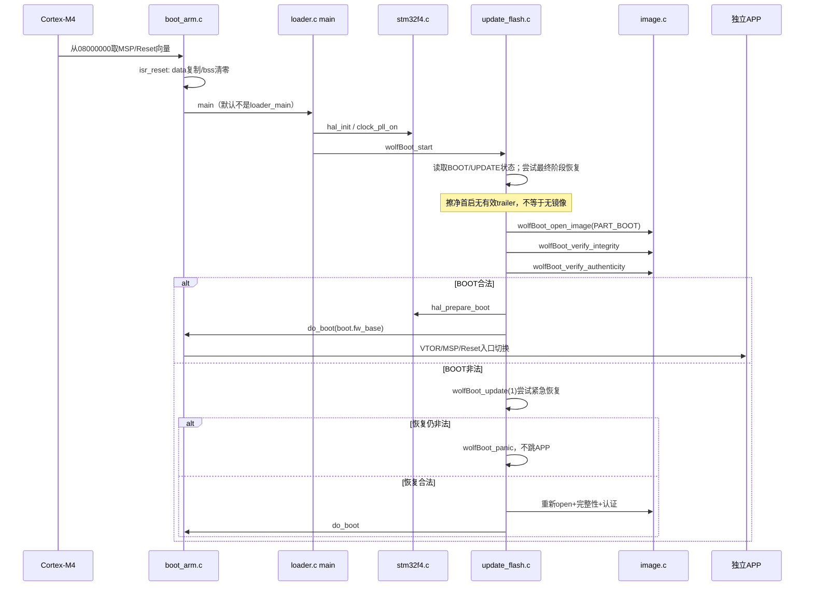
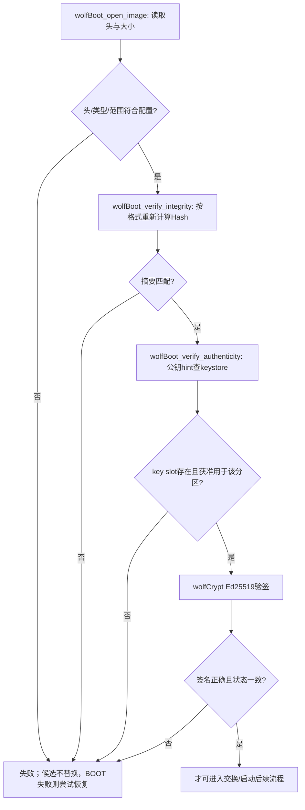
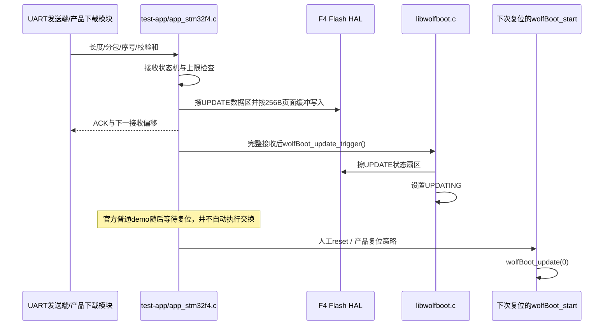
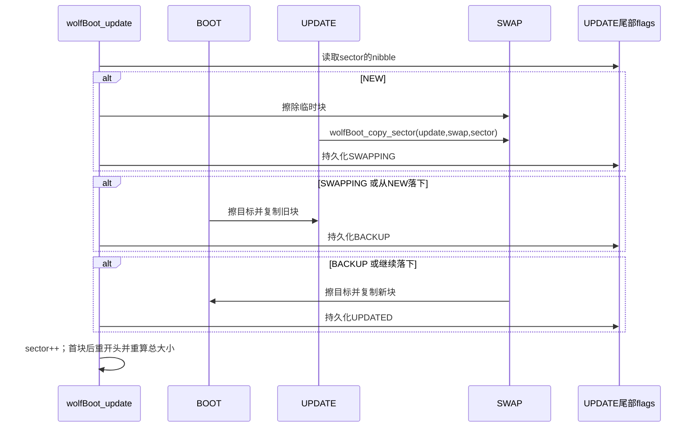
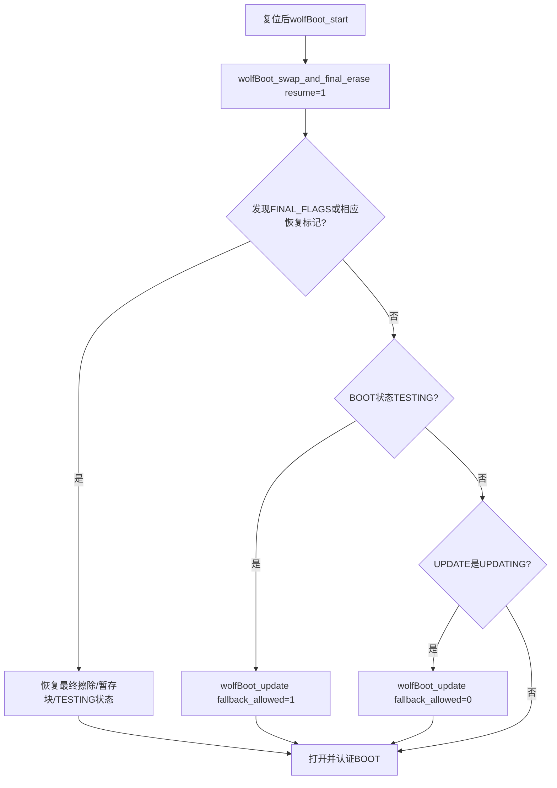
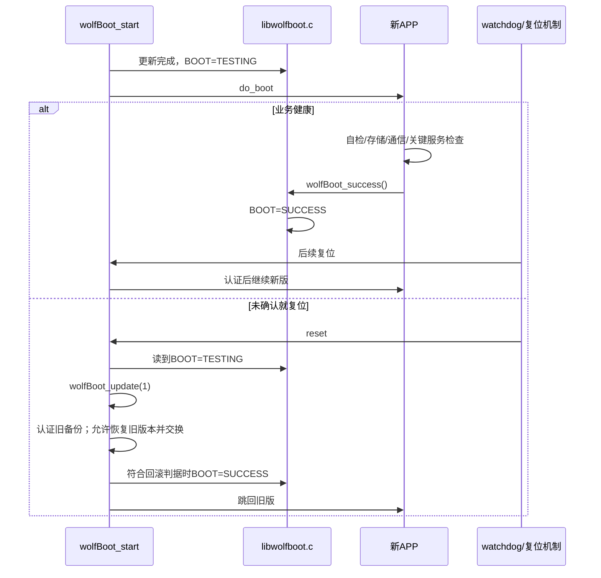
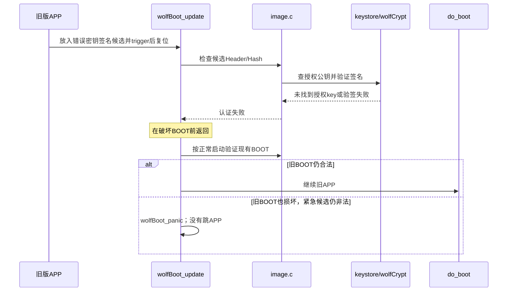

# 5　再做动态设计：每个场景怎样改变镜像和状态

本篇每张图对应本包实际选中的 `src/update_flash.c`，而不是把不同 Bootloader 的概念拼在一起。源码 commit 固定为 `0a3b0f7184a7a3d378e2a63b3d1e9080d03c3f8f`。函数行位置见 [函数索引](source-functions.md)；overlay 不修改交换算法。

## 首启与正常启动

首启不是“先把空 UPDATE 拷到 BOOT”。工厂镜像已经把带签名 v1 放在 BOOT，UPDATING 状态不存在，直接认证它。读取 BOOT state 失败与打开 BOOT image 失败属于两种不同数据：前者读尾部状态 magic，后者解析头部。

`wolfBoot_start()` 先处理未完成的最终擦除/测试失败回滚/请求更新，再打开 BOOT 镜像。认证不只看返回值，还通过 `hdr_ok/sha_ok/signature_ok` 和 sanity 宏检查相关状态；具体加固强度受编译选项影响，不应把一个普通 `if` 当全部防故障注入设计。

## 镜像认证是两道门

`image.c` 负责把不可信输入变成可接受的镜像视图；`wolfCrypt` 只接收已经选好的算法参数、摘要、公钥和签名。Hash 正确但密钥不受信任仍失败；签名长度不符也失败。传输层校验和正确不替代这两道门。

正常候选在 `wolfBoot_update(0)` 内先验证类型、容量、Hash、签名和版本，再破坏 BOOT。交换中断恢复时头可能已经移位，不能机械地重复“按 UPDATE 当前开头验证整份新镜像”——这正是状态与 SWAP 头恢复逻辑存在的理由。

## 下载与触发不在复位启动循环里混做

普通 APP demo 是自定义 UART 协议（同步 A5 5A、长度/偏移/校验等），不是任意串口工具把文件拖进去就能用。`tools/uart-flash-server/` 是供 Bootloader 的 UART_FLASH 外部存储模拟后端使用，和这个 APP 接收协议不同，不能拿来直接发送本例 APP 下载包。本包实操用 OpenOCD 写 UPDATE + APP API trigger，先把“下载链路”和“安全更新链路”分开验证，之后再接 UART/网络下载。

下载中断而没有 trigger 时，正常启动继续旧 BOOT。这个结论依赖没有残留的旧 UPDATING 标记；产品接收端应在新下载前明确准备候选状态区。普通 demo 长度/校验、返回值处理和重入状态并不是完整产品接收规范，例如一次成功下载后它停在等待复位而不是开始第二轮会话。

## SWAP 的真正顺序：先放新块，再腾旧位置

用 N 表示新块，O 表示旧块。最容易讲错的是第一步：当前代码是 **UPDATE→SWAP**，不是先 BOOT→SWAP。

| 持久化边界 | BOOT | UPDATE | SWAP | flag |
|---|---|---|---|---|
| 起始 | O | N | 无要求 | NEW=F |
| 新块已备份 | O | N | N | SWAPPING=7 |
| 旧块已挪走 | O | O | N | BACKUP=3 |
| 新块入位 | N | O | N | UPDATED=0 |

`wolfBoot_copy_sector` 对 SWAP 的偏移始终使用其第一块，对 BOOT/UPDATE 使用相应 sector 偏移。这一块周转空间可以服务多个逻辑块。复制使用小缓冲与 HAL 写入，不需要 128KiB RAM。

**先完成数据，再写完成标记**，让“标记落后于真实数据”可通过重做恢复。若把标记提前写，复位后就可能错误跳过未完成复制。持久化标记并非每字节写必然原子；底层 NOR 编程粒度、半写字节行为与故障模型仍须板测。

源码使用 switch 的 fall-through：NEW 情况下完成第一步后可在同一轮继续 SWAPPING/BACKUP，不必每次 reset 才推进。若读到 UPDATED，就跳过本块。如果某次 copy 返回失败，则锁回 Flash 并返回，不向下推进标记。这是读代码要重点辨认的“继续执行”和“下次启动恢复”的区别。

第一块包含镜像头。交换它以后，BOOT/UPDATE 头已互换，源码会重新 `wolfBoot_open_image`、调整 `fw_size` 并计算剩余范围；不要拿函数入口时两个结构体的大小一直推到底。

## 为什么尾部还要有一个最终阶段

只画上面三步还不够。BOOT/UPDATE 的状态本身在最后 Sector，更新完毕也要清掉旧标记并建立 TESTING；如果恰好清状态时掉电，恢复入口必须仍能辨认。

当前 `wolfBoot_swap_and_final_erase(resume)` 在 `src/update_flash.c` 中承担：

1. 计算状态区前一块 `tmpBootPos`，把需保存的 BOOT 块备份到 SWAP。
2. 在 UPDATE 写 `IMG_STATE_FINAL_FLAGS`，表示进入最终状态处理，重入时不再毁掉已保存的 SWAP。
3. 擦 BOOT 最后状态 Sector；需要时把暂存块还原到 BOOT。
4. 将 BOOT 标记 TESTING，再擦 UPDATE 最后状态 Sector，使下一轮状态干净。

本包未开启外部加密。代码中使用 staging magic 与密钥/nonce 保存的若干分支仅在 `EXT_ENCRYPTED` 下启用；不要把那些写入当成本实验必然发生的动作。重入检测还看 UPDATE 的 FINAL_FLAGS，不能只寻找 staging magic。

本包每个 slot 两个 Sector，但只有前一个放 APP，因此最终阶段保存的 staging 块就是包含镜像的前一块。容量更大时算法还会处理其他数据块。不要为了多放 APP 删除保留状态扇区，而不重写对应状态算法。

## 试运行、确认和回滚

`wolfBoot_success()` 不是写一段日志，而是持久化改变后续 reset 决策。太早调用会把“进入 main 但业务坏了”的固件确认；太晚调用则可能正常业务复位也被视作失败。设计健康确认的时机，比会调用 API 更重要。

正常升级 `wolfBoot_update(0)` 在没有 `ALLOW_DOWNGRADE` 时拒绝同版和旧版。回滚路径 `wolfBoot_update(1)` 有单独允许 fallback 的逻辑；最新 commit 还检查从 SWAP 恢复首块时的版本字段。不能简单地说“所有版本小于当前的都永远不能启动”，也不能为了回滚就全局允许降级。

源码在认定未确认回滚的条件下会把恢复后的 BOOT 标记 SUCCESS，避免不断来回试运行。对异常状态和丢失 trailer，按真实分支验证，不要用一张理想状态图覆盖所有恢复情况。

## 断电续做不是一次重试整个下载

看每个阶段哪份数据还可信：

- NEW 阶段没有提交 SWAPPING 时，UPDATE 仍是候选，重复复制到 SWAP。
- SWAPPING 阶段即使 UPDATE 正在被旧 BOOT 覆盖，新块已在 SWAP；重做 BOOT→UPDATE 后继续。
- BACKUP 阶段旧块已在 UPDATE，新块在 SWAP；可重复 SWAP→BOOT。
- UPDATED 阶段只推进，不再把已经替换的 BOOT 当旧块重复备份。
- 最终阶段靠 FINAL_FLAGS 与相应恢复逻辑清理状态；这里的测试和前三步同样必要。

最新锁定 commit 的提交说明是为 SWAP sector 0 的恢复添加版本检查。`wolfBoot_swap_update_size(fallback_allowed)` 会验证暂存头 magic/大小、版本 TLV 和相关版本约束；`tools/unit-tests/unit-update-flash.c` 有中断恢复、坏 SWAP 头、过大大小、伪造/旧版本等用例。它说明恢复路径也需要输入验证，而不只是把“第一次认证成功”当作永久授权。主机 unit test 存在不表示本次已执行，更不替代板上断电。

## 错误签名与最终拒启

观察失败位置比只看“没更新”更有价值：坏 payload 应在 integrity 阶段失败，错误密钥候选应在 key lookup/验签阶段失败。签名错误被拒、旧版继续运行，是安全更新成功处理错误输入的表现；设备完全拒启只有在没有任何合法启动/恢复选择时才应出现。
