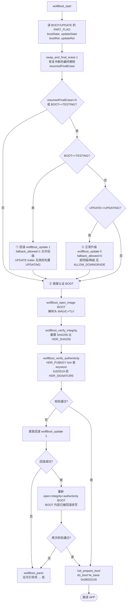
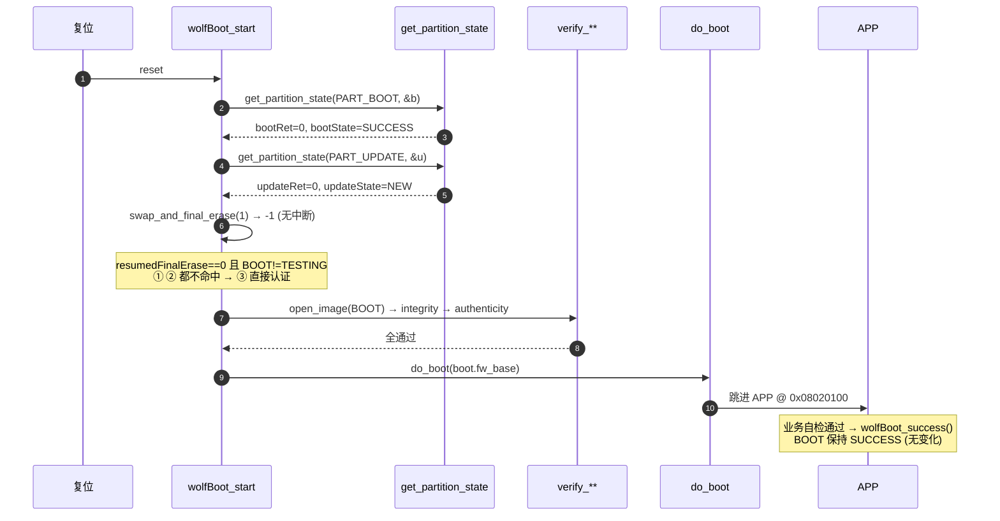
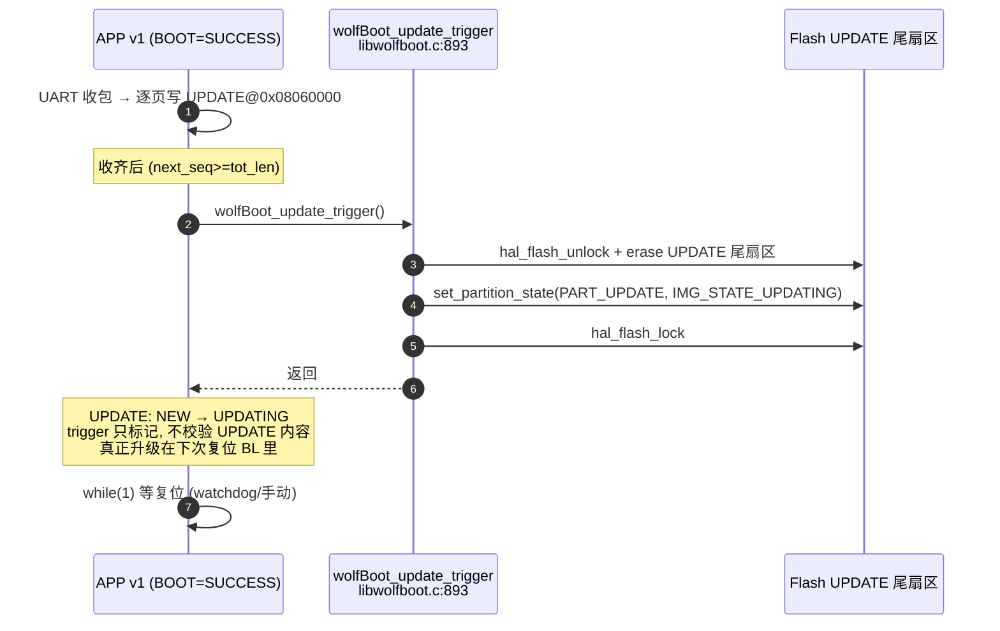
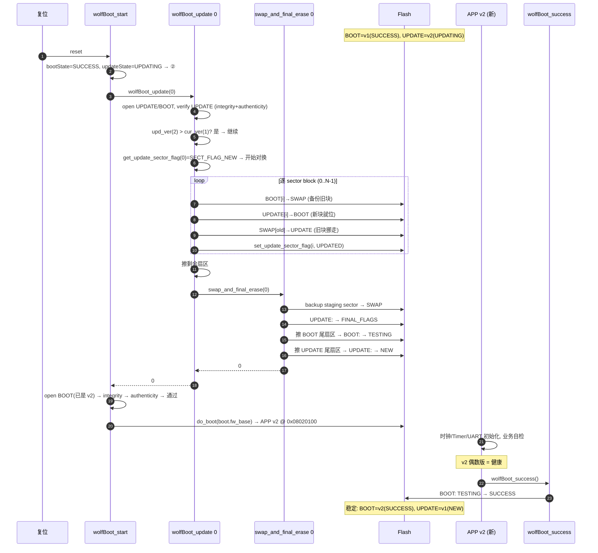
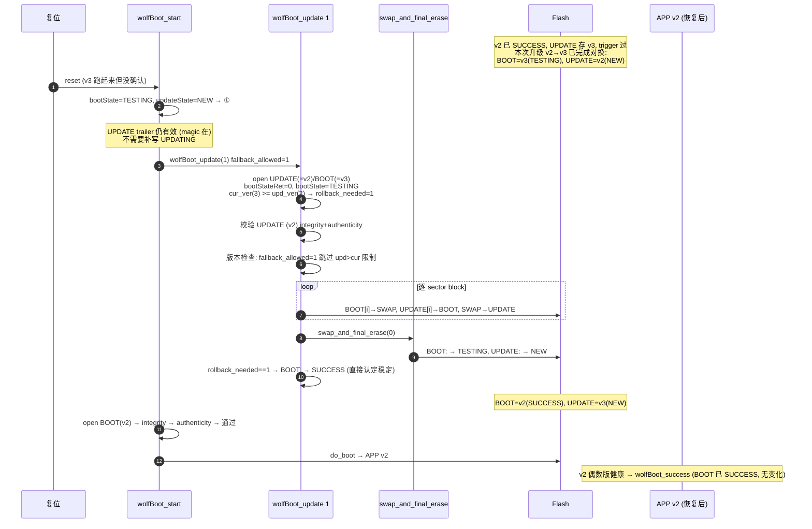
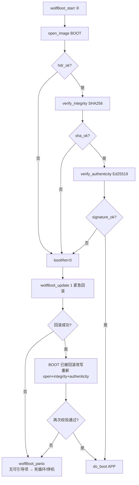
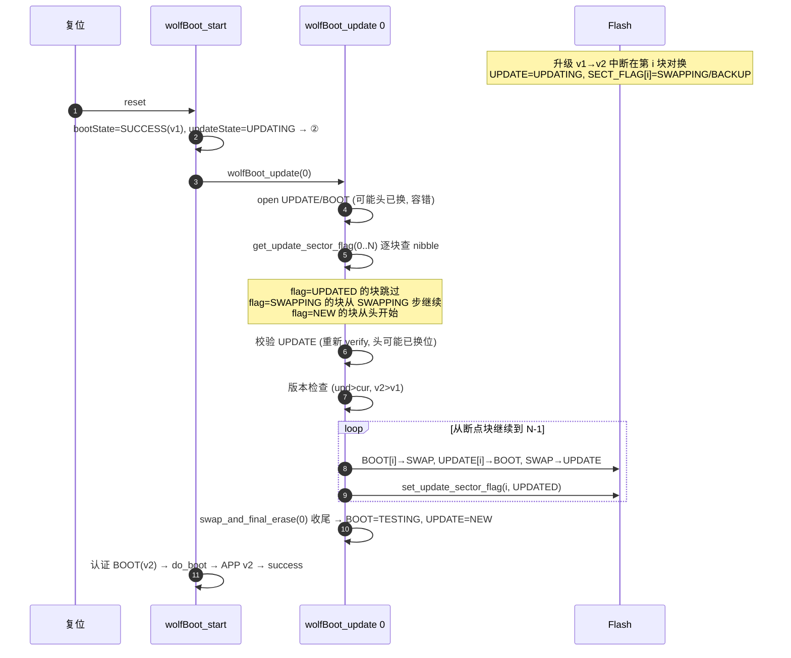
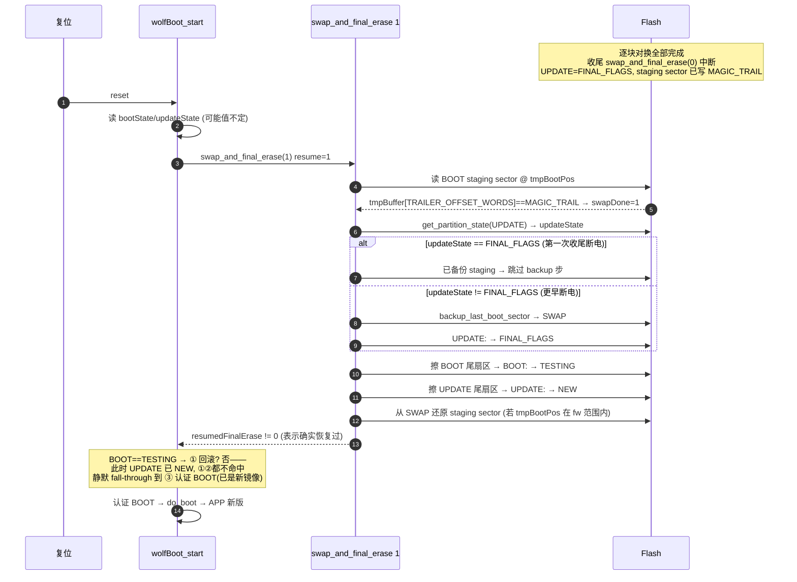
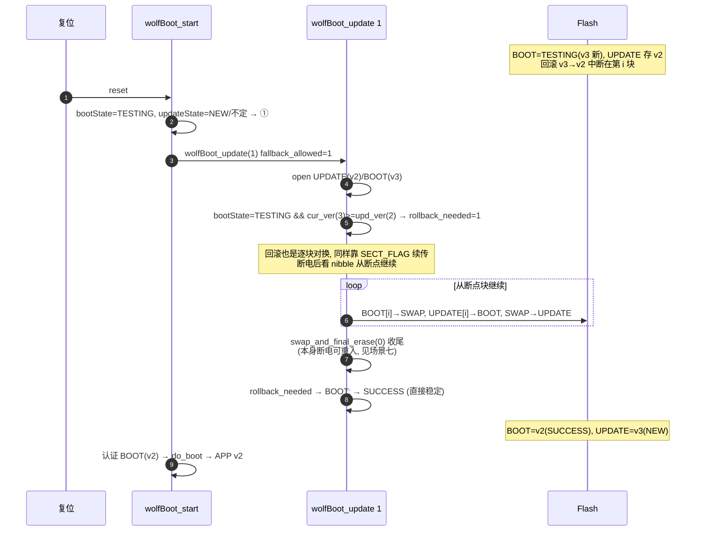

# wolfBoot 分区状态分支全景笔记

> 配套 `notes/note-partition.md`（分区/字段定义）、`notes/note_source_code.md`（源码流程）。本文聚焦**状态流转**：每个 `IMG_STATE_*` 是谁写的、`wolfBoot_start` 据此走哪条分支、各核心场景（含失败/回滚/断电恢复）的完整路径。
> 配置：STM32F407 单 Bank NOR、双分区 + SWAP、`WOLFBOOT_SECTOR_SIZE=128KiB`、`PART_BOOT@0x08020000`、`PART_UPDATE@0x08060000`、`PART_SWAP@0x080A0000`。
> 行号对应 `vendor/wolfBoot` 本快照源码。

---

## 第 1 章　分区状态（PART_FLAG）总览

> 字段位置见 `note-partition.md` 第 3.2 节：每个分区末尾 trailer 偏移 1 处的 1 字节。默认极性（`wolfboot.h:645-657`）。

| 状态 | 值 | 含义 | 写入者 | 读取者 |
|------|----|------|--------|--------|
| `IMG_STATE_NEW` | `0xFF` | 擦净态/无有效 trailer（NOR 擦后即是） | 擦除尾扇区 / 从未写 | `wolfBoot_get_partition_state` 返回此值或 -1 |
| `IMG_STATE_UPDATING` | `0x70` | APP 已请求升级 | **APP** 调 `wolfBoot_update_trigger`（`libwolfboot.c:893`） / **BL** 回滚前补写 | `wolfBoot_start` ②分支 |
| `IMG_STATE_FINAL_FLAGS` | `0x30` | 正在收尾最终擦除 | **BL** `swap_and_final_erase`（`update_flash.c:559`） | `swap_and_final_erase(1)` 判重入 |
| `IMG_STATE_TESTING` | `0x10` | BOOT 刚换完待 APP 确认 | **BL** `swap_and_final_erase`（`:629`）/ `wolfBoot_update` 收尾 | `wolfBoot_start` ①分支 |
| `IMG_STATE_SUCCESS` | `0x00` | APP 已确认，稳定运行 | **APP** `wolfBoot_success`（`libwolfboot.c:964`） / **BL** 回滚后直接认定 | `wolfBoot_start` ③分支（非 TESTING） |

**NOR 物理约束**：只能 `1→0`，擦除才回 `1`。故状态值按 `0xFF → 0x70 → 0x30 → 0x10 → 0x00` 单调"清位"前进；回 `NEW(0xFF)` 必须擦整个状态扇区（128KiB）。这就是 trigger/success/final_erase 都要 `hal_flash_erase(尾扇区)` 的根因。

**扇区进度 nibble（`SECT_FLAG_*`，仅 UPDATE 用）**：逐块对换时 `NEW(0x0F)→SWAPPING(0x07)→BACKUP(0x03)→UPDATED(0x00)`，断电后据此续传（`image.h:46-54`，`update_flash.c:1292`）。

**镜像头状态（独立于 PART_FLAG）**：`hdr_ok`/`sha_ok`/`signature_ok` 三道门，任一失败 → 紧急回滚。

---

## 第 2 章　分区状态转移总图

```mermaid
stateDiagram-v2
    direction LR
    [*] --> NEW : 擦净 / 首启无 trailer

    state "BOOT: NEW/SUCCESS\nUPDATE: NEW" as Stable {
        [*] --> 走 wolfBoot_start ③\n直接认证 BOOT → do_boot
    }

    NEW --> UPDATING : APP: wolfBoot_update_trigger\n(写 UPDATE 尾扇区)

    state "UPDATE: UPDATING" as Upd1
    Upd1 --> wolfBoot_update_0 : 复位进 wolfBoot_start ②\nfallback_allowed=0 拒同版/降级

    state "逐块对换中" as Swapping {
        [*] --> SECT_FLAG_NEW
        SECT_FLAG_NEW --> SECT_FLAG_SWAPPING : BOOT→SWAP 备份
        SECT_FLAG_SWAPPING --> SECT_FLAG_BACKUP : UPDATE→BOOT 新块就位
        SECT_FLAG_BACKUP --> SECT_FLAG_UPDATED : SWAP→UPDATE 旧块挪走
        note right of Swapping
            每块写完立刻标 nibble
            断电后看 nibble 续传
        end note
    }
    wolfBoot_update_0 --> Swapping
    Swapping --> FINAL_FLAGS : swap_and_final_erase(0)\n备份 staging sector 到 SWAP\nUPDATE: → FINAL_FLAGS

    state "最终擦除中" as FinalErase
    FINAL_FLAGS --> FinalErase : 擦 BOOT 尾扇区\nBOOT: → TESTING\n擦 UPDATE 尾扇区 → UPDATE: NEW
    note right of FinalErase
        staging sector 写 MAGIC_TRAIL
        断电后 swap_and_final_erase(1) 重入
    end note

    FinalErase --> Testing : BOOT=TESTING, UPDATE=NEW

    state "BOOT: TESTING" as Test1
    Test1 --> do_boot_APP_new : wolfBoot_start ③ 认证 BOOT\n(此时 UPDATE 已 NEW, ③不命中①②)
    do_boot_APP_new --> APP_runs
    state "APP 运行新镜像" as APP_runs
    APP_runs --> SUCCESS : APP 调 wolfBoot_success\n(业务自检通过)
    APP_runs --> 断电或看门狗 : APP 未调 success
    断电或看门狗 --> Rollback : 复位进 wolfBoot_start ①\nBOOT==TESTING → wolfBoot_update(1)\nfallback_allowed=1 允许旧版

    state "回滚中" as Rollback
    Rollback --> Swapping2 : 用 UPDATE 里的旧版恢复 BOOT\n(同一套逐块对换机制)
    Swapping2 --> FinalErase2 : swap_and_final_erase
    FinalErase2 --> SUCCESS : rollback_needed 时直接\nBOOT: → SUCCESS\n(认定回滚后稳定, 不再 TESTING)

    SUCCESS --> Stable
```

> 图中 "BL" = Bootloader，"APP" = 应用固件。`wolfBoot_update_0`/`wolfBoot_update_1` 是同一函数 `wolfBoot_update(fallback_allowed)` 的两种调用（`update_flash.c:1046`），区别仅在是否跳过"upd_ver > cur_ver"版本检查。

---

## 第 3 章　`wolfBoot_start` 入口分支决策

> 源码 `update_flash.c:1697`。本配置走 `双分区+SWAP` 分支（无 `SELF_UPDATE_MONOLITHIC`/`DISABLE_BACKUP`/`CUSTOM_PARTITION_TRAILER`）。



**三个入口分支判据**：
1. **① BOOT==TESTING → 回滚**：上次 BOOT 换了新镜像但 APP 没确认就复位 → 回到 UPDATE 留的旧版。
2. **② UPDATE==UPDATING → 正常升级**：APP 已 trigger → 校验 UPDATE 通过后逐块对换进 BOOT。
3. **③ 都不是 → 直接认证 BOOT**：系统稳定，UPDATE 是 NEW/空。

> 外层 `resumedFinalErase!=0` 守卫：即使刚恢复完中断、BOOT 已被收尾设成 TESTING 但 UPDATE 已清成 NEW，也进块；块内 ①②都不命中就静默 fall-through 到 ③。

---

## 第 4 章　核心场景流程图

### 4.1 场景一：首启 / 稳定运行（BOOT=SUCCESS, UPDATE=NEW）



### 4.2 场景二：APP 触发升级（trigger，不执行升级）



### 4.3 场景三：正常升级 v1→v2 并确认（核心成功路径）



### 4.4 场景四：不确认回滚（v2→v3 不确认 → 回 v2）


> 关键：回滚用 UPDATE 里留的**旧版**恢复 BOOT。`rollback_needed` 标志让收尾直接把 BOOT 设成 `SUCCESS` 而非 `TESTING`——因为回滚本身就是"放弃新版本、回到已验证的旧版本"，没必要再让 APP 确认一次（否则会陷入"回滚→TESTING→再回滚"的死循环）。

### 4.5 场景五：BOOT 认证失败 → 紧急回滚 → 再失败 panic


> 紧急回滚与场景四走的是同一个 `wolfBoot_update(1)`，区别在触发点：场景四是"状态机①主动回滚"，场景五是"认证三道门失败后被动回滚"。回滚成功后**必须再 open+verify 一次**，因为 BOOT 内容刚被 update 改写过（`update_flash.c:1822-1825`）。两次都失败才 panic——这是"最后一道防线"。

### 4.6 场景六：升级中逐块对换断电恢复


> 续传依据是 `SECT_FLAG_*` nibble（`update_flash.c:1292-1345`）：每个 case 标号对应断电时已完成的阶段，`FALL THROUGH` 继续往下做。`sector==1` 后会重新 `open_image` 重算 `fw_size`/`total_size`，因为第一块换完后头就互换了（`:1366-1377`）。

### 4.7 场景七：最终擦除中断电恢复（swap_and_final_erase 重入）


> `swap_and_final_erase` 的可重入性靠三个信号：① staging sector 里的 `MAGIC_TRAIL`（表示对换已完成、正在收尾）；② UPDATE 的 `FINAL_FLAGS`（表示 backup 步已做，重入时跳过 backup）；③ SWAP 里的 staging sector 备份（收尾中擦 BOOT 尾扇区前先把 staging 存走，收尾末尾再还原）。三者保证收尾阶段任意点断电都能恢复到"BOOT=新镜像(待确认), UPDATE=NEW"的一致态。

### 4.8 场景八：回滚中断电恢复


> 回滚与升级共用同一套逐块对换 + `swap_and_final_erase` 机制，因此**断电恢复能力相同**。区别仅在：① `fallback_allowed=1` 跳过版本检查允许旧版；② `rollback_needed` 标志让收尾直接把 BOOT 设 `SUCCESS` 而非 `TESTING`，避免"回滚后又要 APP 确认"的死循环。

---

## 第 5 章　失败/异常路径汇总

| 触发点 | 现象 | 分支 | 结果 |
|--------|------|------|------|
| 首启无 trailer | `get_partition_state` 返回 -1 | `bootRet/updateRet != 0`，① ② 都不进 → ③ 认证 BOOT | 若 BOOT 镜像合法 → `do_boot`；不合法 → 紧急回滚（场景五） |
| `update_trigger` 时 UPDATE 内容坏 | trigger 只写状态不校验 → UPDATE=UPDATING | 下次复位 ② `wolfBoot_update(0)` 校验失败 → return -1 | BOOT 不变，UPDATE 状态保持 UPDATING（下次还会再试，需 APP 重写或擦 UPDATE） |
| 升级中逐块断电 | `SECT_FLAG[i]` 卡在 SWAPPING/BACKUP | ② `wolfBoot_update(0)` 看 nibble 续传（场景六） | 续传完成 → 收尾 → BOOT=新(TESTING) |
| 最终擦除中断电 | staging sector 有 `MAGIC_TRAIL`，UPDATE=FINAL_FLAGS | `swap_and_final_erase(1)` 重入（场景七） | 恢复到 BOOT=新(TESTING), UPDATE=NEW → ③ 认证 BOOT |
| 新镜像跑起来不确认 | APP 不调 `wolfBoot_success` 就复位 | BOOT=TESTING → ① 回滚（场景四） | BOOT 回到旧版，UPDATE 存被放弃的新版 |
| BOOT 镜像被篡改/损坏 | 认证三道门失败 | 紧急回滚（场景五） | 回滚成功 → 重认证 → `do_boot`；回滚失败 → `wolfBoot_panic` |
| 回滚中断电 | 同升级中断电 | ① 重入 `wolfBoot_update(1)`，靠 nibble 续传（场景八） | BOOT=旧(SUCCESS) |
| 回滚后 BOOT 仍校验不过 | 回滚成功但新写入的旧版也坏 | 二次 open+verify 失败 | `wolfBoot_panic`（无可引导项） |
| `wolfBoot_panic` | 无可引导镜像 | 死循环/停机（`loader.c` 末尾） | 设备 brick，需外部工具重烧 |
| 版本降级（无 ALLOW_DOWNGRADE） | upd_ver <= cur_ver | ② `wolfBoot_update(0)` 版本检查 return -1 | 拒绝升级，BOOT 不变；UPDATE 保持 UPDATING |
| 版本回滚（fallback_allowed=1） | upd_ver < cur_ver 但 BOOT=TESTING | ① `wolfBoot_update(1)` 跳过版本检查 | 允许用旧版恢复 BOOT |

**关键不变量**（断电安全的基础）：
1. **任何时候 BOOT 至少存有一份可引导镜像**：要么 BOOT 自身合法（SUCCESS/TESTING），要么 UPDATE 里有备份可恢复。
2. **逐块对换前必先备份到 SWAP**：BOOT[i]→SWAP 在 UPDATE[i]→BOOT 之前，所以"新块写一半断电"不会丢旧块。
3. **状态字段单调清位**：NOR 只能 1→0，状态只能往"更小的值"走，不会因断电回到中间态。
4. **trailer MAGIC 双校验**：读状态前先验 `WOLFBOOT_MAGIC_TRAIL`，MAGIC 不在则当"无 trailer"处理（返回 -1），不会误用未初始化字节。
5. **回滚用 SUCCESS 而非 TESTING 终态**：避免"回滚→TESTING→未确认→再回滚"死循环。

---

## 附：与其它笔记的衔接

- `notes/note-partition.md`：分区/字段**定义**（trailer 在哪、PART_FLAG 是什么、IMG_STATE_* 取值表）。本文是其**动态行为**展开。
- `notes/note_source_code.md`：源码**流程伪代码**与函数地图。本文的 mermaid 图是其流程的可视化补充。
- `notes/note_debug.md`：**怎么调试**这些分支（断点表、`get_partition_state` 返回 -1 的现场观察）。
- 关键函数行号：`wolfBoot_start`(`update_flash.c:1697`)、`wolfBoot_update`(`:1046`)、`swap_and_final_erase`(`:488`)、`wolfBoot_update_trigger`(`libwolfboot.c:893`)、`wolfBoot_success`(`libwolfboot.c:964`)、`get_partition_state`(`libwolfboot.c:687`)、`set_update_sector_flag`(`libwolfboot.c:764`)。

---

## 一句话总结

`wolfBoot_start` 用 **BOOT 的 PART_FLAG** 判"要不要回滚"、用 **UPDATE 的 PART_FLAG** 判"要不要升级"、用 **BOOT 末尾 staging 的 MAGIC_TRAIL** 判"上次是否断在最终擦除"；三个判据组合出**回滚 / 升级 / 直接认证**三条入口分支，认证失败再叠一层**紧急回滚**。所有分支最终都汇聚到"认证 BOOT → `do_boot`"，认证不过且回滚也失败才 `panic`。逐块对换靠 `SECT_FLAG_*` nibble 续传、最终擦除靠 staging `MAGIC_TRAIL` + `FINAL_FLAGS` 重入，二者共同保证"任何断电点都能恢复到一致态"。
