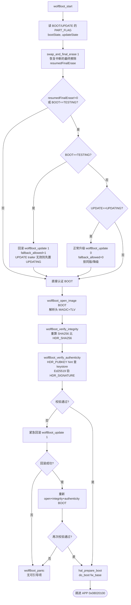

# wolfBoot Partition（分区）设计深度笔记

> 目标配置（`config/explorer-f407.config`）：`IMAGE_HEADER_SIZE=256`、`WOLFBOOT_PARTITION_SIZE=0x40000`（256KiB）、`WOLFBOOT_SECTOR_SIZE=0x20000`（128KiB）、`PART_BOOT@0x08020000`、`PART_UPDATE@0x08060000`、`PART_SWAP@0x080A0000`。
> 芯片：STM32F407ZGT6，1MiB 单 Bank NOR Flash，Cortex-M4。
> 本文回答四个问题：① 什么是 partition；② 整体分区布局图；③ 重要字段及作用；④ `wolfBoot_start` 启动时判断了哪些字段、走了哪些分支。
> 所有路径均为 `vendor/wolfBoot` 下的相对路径，行号对应本快照源码。

---

## 第 1 章　什么是 partition（分区）

在 wolfBoot 里，**partition（分区）是一段连续的、有固定起止地址和统一内部结构的 Flash 区域**，由链接期常量（`WOLFBOOT_PARTITION_*_ADDRESS` / `WOLFBOOT_PARTITION_SIZE`）在 `config/wolfboot.ld` / `config/explorer-f407.config` 里固定下来，运行期不可移动。每个分区承载一个"角色"：

| 分区 ID | 宏 | 数值 | 角色 |
|---------|----|------|------|
| `PART_BOOT` | `PART_BOOT` | `0` | **当前引导分区**：存放"下一次要跳进去的" APP 镜像。Bootloader 校验通过后 `do_boot` 到这里。 |
| `PART_UPDATE` | `PART_UPDATE` | `1` | **升级分区**：APP 把新固件写到这；Bootloader 在下次复位时校验它，通过后把它"对换"进 BOOT。 |
| `PART_SWAP` | `PART_SWAP` | `2` | **交换/备份分区**：升级时逐块备份 BOOT 的旧块，断电可恢复；也用于回滚时存旧版。 |
| `PART_SELF` | `PART_SELF` | `3` | wolfBoot 自身的 self-update 头（本配置未用）。 |
| `PART_NONE` | `PART_NONE` | `0xFF` | "不属于任何分区"的哨兵值。 |

> 定义见 `include/wolfboot/wolfboot.h:634-638`。

**关键概念区分（容易混）**：
- **物理 Flash 扇区**（STM32 硬件扇区，16K/64K/128K 不等，最小擦除粒度）≠ **wolfBoot 分区**（逻辑区域，跨多个硬件扇区）≠ **wolfBoot `WOLFBOOT_SECTOR_SIZE`**（升级时的"块粒度"，本配置 128KiB，等于一个硬件大扇区）。
- **分区 = `WOLFBOOT_PARTITION_SIZE` 连续空间**。本配置 BOOT/UPDATE 各 256KiB，正好 = 2 × `WOLFBOOT_SECTOR_SIZE`。升级以 `WOLFBOOT_SECTOR_SIZE` 为最小搬块单位。
- 每个分区内部又分两段：**前段是镜像载荷**（256B 头 + 固件代码），**末段是状态/trailer 扇区**（存 MAGIC、分区状态字节、扇区进度标志）。这就是 `config/flash-map.csv` 里把每个 128KiB 硬件扇区标成 `*_PAYLOAD` / `*_STATE` 的来由——它标的是**物理扇区角色**，而 wolfBoot 的"分区"是两个相邻物理扇区合并的逻辑区。

---

## 第 2 章　整体分区布局图

### 2.1 物理 Flash 扇区图（来自 `config/flash-map.csv`）

```
STM32F407 1MiB Flash, 单 Bank
┌──────────────────────────────────────────────────────────────────────┐
│ 物理        地址范围                  大小    flash-map 角色           │
├──────────────────────────────────────────────────────────────────────┤
│ S0  0x0800_0000 – 0x0800_3FFF   16KiB   BOOTLOADER  ┐                 │
│ S1  0x0800_4000 – 0x0800_7FFF   16KiB   BOOTLOADER  │ wolfBoot 自身    │
│ S2  0x0800_8000 – 0x0800_BFFF   16KiB   BOOTLOADER  │ 代码 128KiB      │
│ S3  0x0800_C000 – 0x0800_FFFF   16KiB   BOOTLOADER  │ (S0..S4)         │
│ S4  0x0801_0000 – 0x0801_FFFF   64KiB   BOOTLOADER  ┘                 │
├──────────────────────────────────────────────────────────────────────┤
│ S5  0x0802_0000 – 0x0803_FFFF  128KiB   BOOT_PAYLOAD ┐ PART_BOOT      │
│ S6  0x0804_0000 – 0x0805_FFFF  128KiB   BOOT_STATE   ┘ 0x08020000 +0x40000│
├──────────────────────────────────────────────────────────────────────┤
│ S7  0x0806_0000 – 0x0807_FFFF  128KiB   UPDATE_PAYLOAD ┐ PART_UPDATE   │
│ S8  0x0808_0000 – 0x0809_FFFF  128KiB   UPDATE_STATE   ┘ 0x08060000 +0x40000│
├──────────────────────────────────────────────────────────────────────┤
│ S9  0x080A_0000 – 0x080B_FFFF  128KiB   SWAP            PART_SWAP      │
│                                  ↑ 0x080A0000 +0x20000 (1 个扇区)      │
├──────────────────────────────────────────────────────────────────────┤
│ S10 0x080C_0000 – 0x080D_FFFF  128KiB   UNUSED                         │
│ S11 0x080E_0000 – 0x080F_FFFF  128KiB   UNUSED                         │
└──────────────────────────────────────────────────────────────────────┘
```

### 2.2 wolfBoot 逻辑分区图（Bootloader 视角）

```
                 wolfBoot 代码               BOOT 分区              UPDATE 分区           SWAP
        ┌─────────────────────────┐┌─────────────────────────┐┌─────────────────────────┐┌──────────────┐
        │  S0..S4  0x0800_0000    ││  0x0802_0000            ││  0x0806_0000            ││ 0x080A_0000  │
        │  128KiB                 ││  │镜像头 256B│固件代码│ ││  │镜像头 256B│固件代码│ ││  128KiB      │
        │  (wolfBoot 自己)        ││  S5 载荷                ││  S7 载荷                ││  备份/暂存    │
        │                         ││  …                      ││  …                      ││              │
        │                         ││  S6 末尾 trailer:        ││  S8 末尾 trailer:        ││              │
        │                         ││  ┌─ sector flags ─┐    ││  ┌─ sector flags ─┐    ││              │
        │                         ││  │ (UPDATE 用)     │    ││  │ 逐块进度 nibble  │   ││              │
        │                         ││  ├─────────────────┤    ││  ├─────────────────┤    ││              │
        │                         ││  │ PART_FLAG (1B)  │    ││  │ PART_FLAG (1B)  │    ││              │
        │                         ││  │ MAGIC    (4B)   │    ││  │ MAGIC    (4B)   │    ││              │
        │                         ││  └─ 0x0805_FFFB…FFFF ┘   ││  └─ 0x0809_FFFB…FFFF ┘   ││              │
        │                         │└────────0x0805_FFFF───────┘└────────0x0809_FFFF───────┘└──0x080B_FFFF─┘
```

### 2.3 一个分区内部的两段结构（以 BOOT 为例）

```
PART_BOOT 起 0x0802_0000                                          PART_BOOT 末 0x0806_0000(不含)
│                                                                   │
▼  IMAGE_HEADER_SIZE=256                                            ▼
┌──────────────────────┬────────────────────────────────────────────┬──────┬───────┐
│  镜像头 256B          │             固件代码 (fw)                  │ pad  │trailer│
│  ┌────────────────┐  │  fw_base = 头基址 + 256                      │      │       │
│  │ MAGIC 'WOLF'   │  │  fw_size  = 头里 TLV 记的长度               │      │       │
│  │ + TLV 链        │  │                                            │      │       │
│  │  · VERSION      │  │  APP 的向量表在第 +256 处（do_boot 跳这）  │      │       │
│  │  · IMG_TYPE     │  │                                            │      │       │
│  │  · SHA256       │  │                                            │      │       │
│  │  · PUBKEY hint  │  │                                            │      │       │
│  │  · SIGNATURE    │  │                                            │      │       │
│  │  · HDR_END      │  │                                            │      │       │
│  └────────────────┘  │                                            │      │       │
└──────────────────────┴────────────────────────────────────────────┴──────┴───────┘
                                                                                  ▲
                            末尾 5 字节 trailer（在最后一个硬件扇区 S6 的尾部）────┘
                            ┌──────────────────────────────────────────────────┐
                            │ … 扇区进度 flags (SECTOR_FLAGS_SIZE=0x1FFFB B)    │
                            │ PART_FLAG (1B)  @ 0x0805_FFFB   ← 分区状态字节    │
                            │ MAGIC     (4B)  @ 0x0805_FFFC   ← "BOOT" 0x544F4F42│
                            └──────────────────────────────────────────────────┘
```

> Trailer 指针 `PART_BOOT_ENDFLAGS = WOLFBOOT_PARTITION_BOOT_ADDRESS + WOLFBOOT_PARTITION_SIZE = 0x08060000`（分区**末尾后一字节**）。`get_trailer_at(part, at)` 取 `ENDFLAGS - (4 + at)`：`at=0`→MAGIC(4B)，`at=1`→PART_FLAG(1B)，`at≥2`→扇区 flag 字节。见 `src/libwolfboot.c` 中 `get_trailer_at` / `get_partition_magic` / `get_partition_state` / `get_update_sector_flags`。

---

## 第 3 章　重要字段清单与作用

wolfBoot 的字段分两块：**镜像头（image header）字段**描述"这个固件是什么"，**分区 trailer 字段**描述"这个分区当前处于升级流程的哪一步"。

### 3.1 镜像头字段（每个分区的载荷起始 256B，`include/wolfboot/wolfboot.h`）

| 字段 | 类型/长度 | 位置 | 作用 |
|------|----------|------|------|
| `WOLFBOOT_MAGIC` | 4B，常量 `0x464C4F57`("WOLF" 小端) | 头偏移 0 | 标识"这是一个 wolfBoot 镜像头"。`wolfBoot_open_image` 第一关就校验它，不匹配判头损坏。 |
| 长度/版本基字 | 4B（`WOLFBOOT_HDR_U32_SZ`） | 头偏移 4 | 存镜像总长度等；`IMAGE_HEADER_OFFSET = 2*U32_SZ = 8` 是 TLV 起点。 |
| TLV 链 | 变长 | 头偏移 8 起 | `type(2B) | len(2B) | value(len)` 反复，以 `HDR_END`(0x00) 终止；`wolfBoot_find_header` 遍历它。 |
| `HDR_VERSION` (0x01) | 4B | TLV | 固件版本号；防降级/回滚就比这个（`cur_ver` vs `upd_ver`）。 |
| `HDR_SHA256` (0x03) | 32B | TLV | 固件摘要；`wolfBoot_verify_integrity` 重算 SHA256 与之比对。 |
| `HDR_IMG_TYPE` (0x04) | 2B | TLV | 高 8 位=签名算法（`HDR_IMG_TYPE_AUTH_MASK`，本配置 `AUTH_ED25519`），低 4 位=分区 ID（`HDR_IMG_TYPE_PART_MASK`，`APP=0x1`）。校验"这固件是给 APP 分区用的、用 ED25519 签的"。 |
| `HDR_PUBKEY` (0x10) | 公钥+hint | TLV | 签名公钥及其 hint（公钥自身的摘要）；`wolfBoot_verify_authenticity` 用 hint 在 `keystore.c` 公钥表里查匹配 slot。 |
| `HDR_SIGNATURE` (0x20) | 64B(Ed25519) | TLV | 对头+固件的签名；用上面公钥验。 |
| `HDR_END` (0x00) | — | TLV 末 | TLV 链终止符。 |
| `IMAGE_HEADER_SIZE` | 256B | 头总长 | 固件代码 `fw_base = 头基址 + 256`；APP 向量表就在 `fw_base`。 |

> 头里所有 TLV 字段都被签名覆盖；改任何一字节签名即失效。设备只存公钥（`keystore.c`），私钥在主机签名工具。

### 3.2 分区 trailer 字段（每个分区末尾，`src/libwolfboot.c`）

| 字段 | 长度 | 位置（BOOT） | 作用 | 读写函数 |
|------|------|-------------|------|---------|
| `WOLFBOOT_MAGIC_TRAIL` | 4B，`0x544F4F42`("BOOT" 小端) | `0x0805_FFFC..FFFF` | 标识"trailer 已建立/有效"。读状态前先校验它；不匹配 `wolfBoot_get_partition_state` 返回 -1。 | `get_partition_magic` / `set_partition_magic` |
| **PART_FLAG / 分区状态字节** | 1B | `0x0805_FFFB` | **本分区当前所处的状态机阶段**，取 `IMG_STATE_*` 之一（见下）。这是 `wolfBoot_start` 判断分支的核心字段。 | `get_partition_state` / `set_partition_state`（`at=1`） |
| 扇区进度 flag | nibble(4b)×2/字节 | `0x0805_FFFA` 起向前 `SECTOR_FLAGS_SIZE=0x1FFFB` B | 仅 **UPDATE 分区**用：逐块对换时标记每个 block 的进度（`SECT_FLAG_NEW/SWAPPING/BACKUP/UPDATED`），断电后据此续传或跳过已完成块。 | `get_update_sector_flags` / `set_update_sector_flags`（`at=2+pos`） |

### 3.3 `IMG_STATE_*`（PART_FLAG 取值，默认极性，`wolfboot.h:645-657`）

| 常量 | 值 | 含义 | 谁写 | 谁读 |
|------|----|------|------|------|
| `IMG_STATE_NEW` | `0xFF` | 擦净态/无有效 trailer（NOR 擦后是 0xFF） | 擦除或从未写 | `wolfBoot_get_partition_state` 返回此值时表示"新分区" |
| `IMG_STATE_UPDATING` | `0x70` | APP 已调 `wolfBoot_update_trigger()`，**请求升级** | `wolfBoot_update_trigger`（写 UPDATE） / 回滚时由 `wolfBoot_start` 补写 | `wolfBoot_start`：UPDATE==UPDATING → 走 `wolfBoot_update(0)` 正常升级 |
| `IMG_STATE_FINAL_FLAGS` | `0x30` | **最终擦除阶段**标记，表示"对换已完成、正在收尾擦除" | `wolfBoot_swap_and_final_erase` 写 UPDATE | `wolfBoot_swap_and_final_erase`：据此判断是否第一次进入收尾、能否安全重入 |
| `IMG_STATE_TESTING` | `0x10` | BOOT **刚换完、待 APP 确认**；APP 若不调 `wolfBoot_success`，下次复位回滚 | `wolfBoot_swap_and_final_erase` 收尾时写 BOOT | `wolfBoot_start`：BOOT==TESTING → 走 `wolfBoot_update(1)` 回滚 |
| `IMG_STATE_SUCCESS` | `0x00` | APP 已调 `wolfBoot_success`，BOOT 稳定运行 | `wolfBoot_success` / `wolfBoot_update` 收尾分支 | `wolfBoot_start`：既非 TESTING 也非（UPDATE 的）UPDATING → 直接认证 BOOT |

> NOR Flash 物理特性：只能 `1→0`，擦除才把位复位回 `1`。所以这些值不是随便选的——从 `NEW(0xFF)` 单调地"清位"走到 `UPDATING(0x70)→...→SUCCESS(0x00)`，每一步都能在不擦除的情况下靠"再写一次更小的值"推进；要回到 `NEW` 必须擦整个状态扇区。这是断电安全的状态编码基础。

### 3.4 `SECT_FLAG_*`（UPDATE 扇区进度 nibble，`image.h:46-54`）

| 常量 | 值 | 含义 |
|------|----|------|
| `SECT_FLAG_NEW` | `0x0F` | 该 block 尚未开始对换 |
| `SECT_FLAG_SWAPPING` | `0x07` | 正在对换中（BOOT→SWAP 已做，UPDATE→BOOT 进行中） |
| `SECT_FLAG_BACKUP` | `0x03` | 旧块已备份到 SWAP，新块已就位 BOOT |
| `SECT_FLAG_UPDATED` | `0x00` | 完成（旧块也挪到 UPDATE 了） |

> 每字节装 2 个 nibble，故 1 字节 track 2 个 block；`wolfBoot_set_update_sector_flags` 做读-改-写保留另一半。断电后 `wolfBoot_update` 看 nibble 决定从哪个 block 继续。

### 3.5 运行期视图字段（`struct wolfBoot_image`，`image.h:157-178`）

不是 Flash 格式，是 Bootloader 解析头后建立的内存视图：

| 字段 | 作用 |
|------|------|
| `hdr` | 镜像头基址（分区起始地址） |
| `fw_base` | 固件代码基址 = `hdr + IMAGE_HEADER_SIZE`(256)；`do_boot` 跳这 |
| `fw_size` | 固件长度，来自 TLV / `wolfBoot_get_total_size` |
| `part` | 该镜像所在分区 ID（`PART_BOOT`/`PART_UPDATE`） |
| `hdr_ok` / `sha_ok` / `signature_ok` | 三道门各自的结果（1=通过）；带 `canary_FEED*` 和 `not_*` 反码做 FI 硬化 |

---

## 第 4 章　`wolfBoot_start` 启动判断与分支

> 源码：`src/update_flash.c:1697`。本配置走 `!WOLFBOOT_SELF_UPDATE_MONOLITHIC && !DISABLE_BACKUP && !CUSTOM_PARTITION_TRAILER` 分支（双分区 + SWAP 备份模式）。本配置未定义 `NVM_FLASH_WRITEONCE`/`EXT_FLASH`/`EXT_ENCRYPTED`/`DELTA_UPDATES`，故相关 `#ifdef` 全折叠。

### 4.1 启动时被判断的字段（按代码顺序）

| 顺序 | 读取的字段 | 通过的函数 | 用途 |
|------|-----------|-----------|------|
| 1 | **BOOT trailer MAGIC** | `wolfBoot_get_partition_state(PART_BOOT,&bootState)` | 校验 BOOT trailer 有效；失败 `bootRet=-1` |
| 2 | **BOOT PART_FLAG** | 同上回写 `bootState` | 判断 BOOT 是否处于 `TESTING` |
| 3 | **UPDATE trailer MAGIC** | `wolfBoot_get_partition_state(PART_UPDATE,&updateState)` | 校验 UPDATE trailer 有效；失败 `updateRet=-1` |
| 4 | **UPDATE PART_FLAG** | 同上回写 `updateState` | 判断 UPDATE 是否处于 `UPDATING` |
| 5 | **BOOT 末尾 staging 区的 MAGIC_TRAIL** | `wolfBoot_swap_and_final_erase(1)` | 判断上次是否断在"最终擦除"阶段，是则恢复 |
| 6 | **UPDATE PART_FLAG**（再次） | `wolfBoot_swap_and_final_erase` 内部 | 判断是否 `FINAL_FLAGS`（重入收尾用） |
| 7 | **BOOT 镜像头 MAGIC + TLV** | `wolfBoot_open_image(&boot,PART_BOOT)` | 解析头、建视图、算 `fw_base/fw_size` |
| 8 | **BOOT `HDR_SHA256`** | `wolfBoot_verify_integrity(&boot)` | 重算 SHA256 比对 |
| 9 | **BOOT `HDR_PUBKEY` hint + `HDR_SIGNATURE`** | `wolfBoot_verify_authenticity(&boot)` | keystore 查公钥 → Ed25519 验签 |

> 第 1–6 步在"状态机"段；第 7–9 步在"认证 BOOT"段。状态机段失败会调 `wolfBoot_update` 改写 BOOT；认证段失败会走紧急回滚。

### 4.2 状态机分支（核心决策树）

```
wolfBoot_start():
  bootRet    = wolfBoot_get_partition_state(PART_BOOT,   &bootState)    # 读 BOOT PART_FLAG
  updateRet  = wolfBoot_get_partition_state(PART_UPDATE, &updateState)  # 读 UPDATE PART_FLAG

  resumedFinalErase = wolfBoot_swap_and_final_erase(1)                   # 恢复中断的最终擦除
                                                                         # 返回非0 = 确实恢复过 / -1 = 无中断可恢复

  if (resumedFinalErase != 0) OR (bootRet==0 AND bootState==IMG_STATE_TESTING):
  └─ if (bootRet==0 AND bootState==IMG_STATE_TESTING):                  # ① BOOT 处于 TESTING
  │     # 上次启动的 BOOT 还没被 APP 确认成功 → 回滚到 UPDATE 里的旧版
  │     if (updateRet != 0):                                             #     UPDATE trailer 无效/缺失
  │         wolfBoot_set_partition_state(PART_UPDATE, IMG_STATE_UPDATING)#     先把 UPDATE 标成 UPDATING
  │         updateState = IMG_STATE_UPDATING                            #     这样 wolfBoot_update(1) 能从 SWAP 恢复
  │     wolfBoot_update(1)                                               # ★ 回滚（fallback_allowed=1，允许旧版）
  │
  └─ elif (updateRet==0 AND updateState==IMG_STATE_UPDATING):           # ② UPDATE 处于 UPDATING
        # APP 已 wolfBoot_update_trigger() 过 → 正常升级
        wolfBoot_update(0)                                               # ★ 正常升级（fallback_allowed=0，拒同版/降级）

  # ③ 上面都不命中（BOOT!=TESTING 且 UPDATE!=UPDATING 且无中断恢复）→ 跳过状态机，直接认证 BOOT
```

**三个分支的含义**：

1. **BOOT==TESTING → 回滚 `wolfBoot_update(1)`**
   上次复位时 BOOT 被换成了新镜像并标成 TESTING，但 APP 跑起来后**没调 `wolfBoot_success()`** 就复位了（业务自检失败 / 看门狗 / 掉电）。说明新镜像"不可信"，回到 UPDATE 里留的旧版。`fallback_allowed=1` 允许用比当前旧的镜像恢复。

2. **UPDATE==UPDATING → 正常升级 `wolfBoot_update(0)`**
   APP 收包写完 UPDATE 后调了 `wolfBoot_update_trigger()`，把 UPDATE 标成 UPDATING。复位进 Bootloader，校验 UPDATE 通过后逐块对换进 BOOT。`fallback_allowed=0` → 拒同版/降级（无 `ALLOW_DOWNGRADE`）。

3. **都不是 → 直接认证 BOOT**
   BOOT 已 SUCCESS、UPDATE 是 NEW/空。说明系统稳定，不需要升级/回滚，直接校验当前 BOOT 并跳转。

> 注意外层 `if (resumedFinalErase != 0 || BOOT==TESTING)`：即使没走到 ① ②（比如刚恢复完中断、BOOT 已被收尾设成 TESTING 但 UPDATE 状态已清成 NEW），只要 `resumedFinalErase!=0` 也进这个块；块内 ① ②都不命中就静默 fall-through 到认证 BOOT。`swap_and_final_erase(1)` 收尾时会把 BOOT 设成 `TESTING`，所以"刚升级完"的下次复位会命中 ①（如果 APP 还没确认）——这正是 TESTING 语义所在。

### 4.3 认证 BOOT 段分支（状态机之后）

```
  bootRet = wolfBoot_open_image(&boot, PART_BOOT)          # 解析头
  if (bootRet >= 0)
      bootRet = wolfBoot_verify_integrity(&boot)            # SHA256
  if (bootRet >= 0)
      bootRet = wolfBoot_verify_authenticity(&boot)         # Ed25519 验签

  if (bootRet < 0):                                         # BOOT 校验失败
      if (wolfBoot_update(1) < 0):                          # 紧急回滚仍失败
          wolfBoot_panic()                                  # ★ 无可引导项 → 死
      else:                                                  # 紧急回滚成功，BOOT 内容已被改写
          if (wolfBoot_open_image(&boot, PART_BOOT) < 0
           || wolfBoot_verify_integrity(&boot) < 0
           || wolfBoot_verify_authenticity(&boot) < 0):
              wolfBoot_panic()                              # ★ 回滚后仍校验不过 → 死

  hal_prepare_boot()                                        # 可选降回 HSI（RESTORE_CLOCK=1）
  do_boot(boot.fw_base)                                      # ★ 跳 APP @ 0x08020100
```

### 4.4 整体启动分支流（Mermaid）



### 4.5 一句话总结：每个字段在启动时干什么

| 字段 | 在 `wolfBoot_start` 里的作用 |
|------|-----------------------------|
| BOOT trailer **MAGIC** | 决定 `bootRet` 是否 0；MAGIC 缺失（擦净首启）`bootRet=-1`，状态机 ①②都进不去 → 直接认证 BOOT |
| BOOT **PART_FLAG** | 等于 `IMG_STATE_TESTING` → 触发回滚分支 ① |
| UPDATE trailer **MAGIC** | 决定 `updateRet` 是否 0；MAGIC 缺失 → ②不进、且 ①里要先补写 UPDATE=UPDATING 才能回滚 |
| UPDATE **PART_FLAG** | 等于 `IMG_STATE_UPDATING` → 触发正常升级 ②；等于 `FINAL_FLAGS` → 帮 `swap_and_final_erase` 判重入 |
| BOOT 末尾 **staging MAGIC_TRAIL** | `swap_and_final_erase(1)` 探测它判断上次是否断在最终擦除，是则恢复 |
| BOOT 镜像头 **MAGIC/TLV/SHA256/PUBKEY/SIGNATURE** | 认证段三道门；任一失败 → 紧急回滚 → 再失败 panic |

---

## 第 5 章　常见误读与要点

1. **"trailer MAGIC 缺失 ≠ 无镜像"**：擦净首启时分区尾全是 0xFF，`WOLFBOOT_MAGIC_TRAIL` 读不到，`wolfBoot_get_partition_state` 返回 -1。这不代表 BOOT 分区没固件，只是状态还没建立。`wolfBoot_start` 这种情况下 ①②都不进，直接走认证 BOOT；认证通过就 `do_boot`，并在后续 `wolfBoot_success` 时建立 trailer。见 `notes/note_debug.md` 故障表与 `docs/04-static.md`。
2. **PART_FLAG 是"分区状态"，不是"镜像状态"**：它描述的是"这个分区在升级流程里处于哪一步"，由 Bootloader/APP 在升级各阶段写入；镜像本身的好坏由头的 SHA256+签名决定。两者独立。
3. **BOOT 的 PART_FLAG 才有 TESTING/SUCCESS 语义**；UPDATE 的 PART_FLAG 用 UPDATING/FINAL_FLAGS/NEW。`wolfboot.h` 注释明确：`TESTING` 只在 BOOT 分区有意义，不与 UPDATE 的 `UPDATING` 冲突。
4. **写一个状态字节要擦整个状态扇区**：因为 trailer 在 128KiB 扇区尾部，NOR 只能 `1→0`，状态只能单调"清位"前进；要回到 `NEW(0xFF)` 必须擦整个 S6/S8 扇区。这就是 `wolfBoot_update_trigger` / `wolfBoot_success` / `swap_and_final_erase` 都要 `hal_flash_erase(尾扇区)` 的原因。
5. **SWAP 分区无 trailer**：它只是临时备份区，`get_trailer_at(PART_SWAP, …)` 不被状态机用；`part_address()` 把 SWAP 地址映射成 `PART_SWAP` 仅用于加密流同步，不读状态。
6. **`wolfBoot_get_partition_state` 返回 -1 必须当"无有效 trailer"处理**，不能只看 `*st`：否则会把擦净的 0xFF（恰好等于 `IMG_STATE_NEW`）误判成"NEW 状态"。本配置 `wolfBoot_start` 正确地用 `bootRet==0`/`updateRet==0` 守卫了后续比较。
7. **分区大小 = 2 × 扇区大小是本配置的巧合**，不是 wolfBoot 的约束。wolfBoot 只要求 `WOLFBOOT_PARTITION_SIZE` 是 `WOLFBOOT_SECTOR_SIZE` 的整数倍，且 BOOT/UPDATE 等大（除非 `SELF_UPDATE_MONOLITHIC`）。

---

## 附：与其它笔记的衔接

- `notes/note_source_code.md`：**源码在做什么、怎么读**（函数地图、流程伪代码、知识点）。本文是其"分区/字段"维度的展开。
- `notes/note_debug.md`：**怎么调试**（断点表、`get_partition_state` 返回 -1 的现场观察）。
- `docs/source-functions.md`：所有源函数行号索引；本文"文件:行"多取自这里。
- 关键函数行号：`wolfBoot_start`(`update_flash.c:1697`)、`wolfBoot_swap_and_final_erase`(`:488`)、`wolfBoot_update`(`:1046`)、`wolfBoot_get_partition_state`(`libwolfboot.c:796`)、`get_trailer_at`/`get_partition_state`(`libwolfboot.c` ~435-690)。
